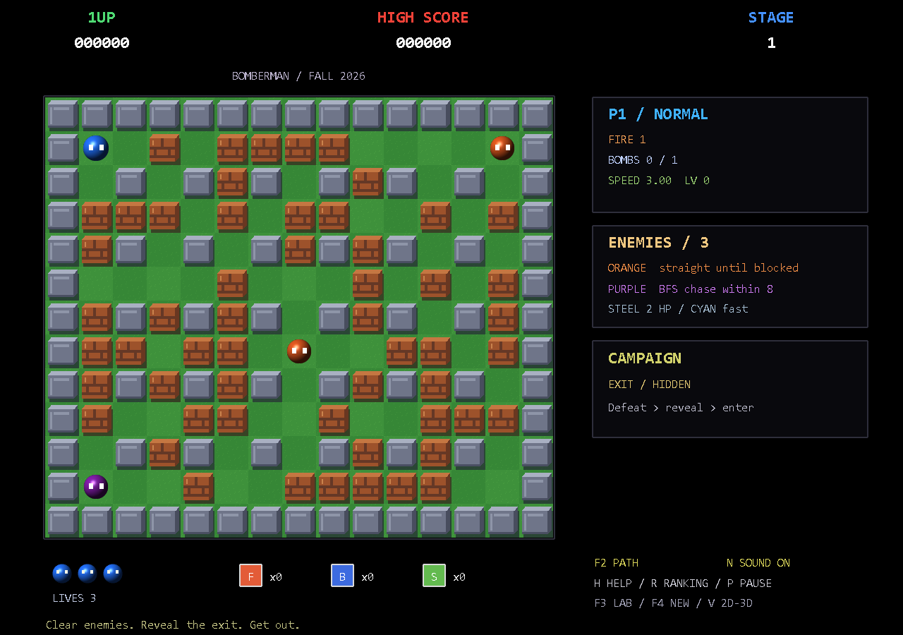
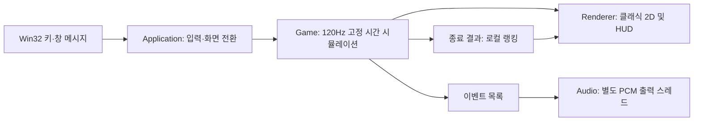

# BOMBER / LAB — C++ Bomberman Final Project Demo

`final_project.pdf`의 기본 규칙 ①~⑳과 advanced 항목을 구현한 Windows 1인용 데모입니다. 추가점수 기능 중 2인용은 이번 요청으로 삭제했습니다. C++17, Win32, OpenGL의 2D 텍스처 매핑을 사용하며, 그림·음악은 코드에서 직접 생성합니다. 인터넷, 외부 에셋, 별도 게임 엔진 설치 없이 실행할 수 있습니다.

UI/UX 브랜치는 `final_project_modification/1122(4)`를 기준으로 초록 타일·입체 블록·파란 구형 캐릭터와 1UP/HIGH SCORE/STAGE 화면을 반영했습니다. 모든 화면은 클래식 2D UI를 사용합니다. 자세한 대응표는 [1122(4) 반영 내역](docs/UIUX_1122.md)에 있습니다.

[17:29 commit 수정 메모](docs/CHANGES_1729.md): 1인 전용·방향키 이동·부서진 블록 칸의 화염을 반영했습니다. 현재 수정 소스는 이 저장소의 로컬 `main` 브랜치 `src/`에 있으며 Git 추적 대상입니다. 루트의 **`Run Demo.cmd`**로 실행합니다.



## 1. 바로 실행

GitHub에는 소스·문서·빌드 설정을 올립니다. 처음 내려받았다면 아래 GCC 또는 Visual Studio/CMake 방법으로 먼저 빌드하세요. `build/`의 실행 파일과 `dist/`의 배포 ZIP은 로컬에서 생성합니다. 빌드할 게임 대상은 **`BombermanDemo`**, 규칙 테스트 대상은 `bomber_tests`입니다.

1. **`Run Demo.cmd`를 더블클릭**합니다. 현재 소스보다 새 실행 파일을 골라 실행하고, 없으면 GCC 또는 Visual Studio로 빌드합니다. 브랜치를 바꾼 뒤 예전 실행 파일을 여는 문제를 방지합니다.
2. 홈 화면은 타이틀 로고와 미리보기 맵을 보여줍니다. **Space 또는 1**로 1인 게임을 시작합니다. 이동은 **방향키만** 사용합니다. STAGE 준비 화면은 1.2초 뒤 진행되며 Space/Enter로 바로 시작할 수도 있습니다.
3. 채점 항목을 빠르게 확인하려면 **F3**으로 기능별 연습 장면에 들어갑니다. F3을 누를 때마다 다음 장면으로 바뀝니다.
4. **F1** 도움말, **F2** BFS 경로, **F4** 일반 캠페인으로 복귀입니다.

실행 환경은 Windows 10/11 x64와 데스크톱 OpenGL 1.1 이상입니다. 제공 실행 파일은 GCC 런타임을 정적으로 링크합니다. OpenGL·GDI·waveOut은 Windows의 시스템 기능을 사용합니다. 실행 파일 폴더에는 랭킹과 캡처를 저장할 쓰기 권한이 필요합니다.

### 직접 빌드 및 테스트

이 컴퓨터의 MSYS2 UCRT64 GCC로 빌드할 수 있습니다.

```powershell
git clone https://github.com/2026PM-final-project/final-project.git
cd final-project
.\build.ps1
.\build\BombermanDemo.exe
```

`build.ps1`은 테스트 실행 파일을 먼저 빌드·실행하고, 전부 통과해야 게임을 빌드합니다. **실행 중인 게임은 닫은 뒤 다시 빌드**해야 합니다. 테스트만 실행하려면 `./build.ps1 -TestOnly`입니다.

Visual Studio의 C++ 데스크톱 개발 도구가 설치된 다른 PC에서는 CMake를 사용할 수 있습니다. GCC 15.2.0과 Visual Studio 솔루션(v143)의 Debug·Release 빌드를 확인했습니다.

```powershell
cmake -S . -B build-vs -G "Visual Studio 17 2022" -A x64
cmake --build build-vs --config Release
ctest --test-dir build-vs -C Release --output-on-failure
.\build-vs\Release\BombermanDemo.exe
```

게임 코어와 규칙 테스트는 Windows API에 의존하지 않습니다. 다른 OS에서도 CMake로 `bomber_tests`를 빌드할 수 있지만, 그래픽 게임 창은 Windows용입니다.

## 적 속도 실험 (`speed_changes`)

게임을 시작하면 오른쪽 **ENEMY SPEED LAB**에서 일반·Tracker(Chaser)·장갑·고속 적을 각각 마우스로 조절합니다. 범위는 **0.00~6.00칸/초**, 간격은 **0.05**이며 즉시 적용합니다. **RESET ALL**은 기본값 복원, **F6**은 패널 표시/숨기기, **P**는 일시정지입니다. 속도를 바꾼 판은 랭킹에서 제외하며 설정은 현재 실행 중에 유지합니다. 자세한 사용법과 비교 실험 제안은 [적 속도 실험 가이드](docs/SPEED_TUNING.md)에 있습니다.

## 2. 조작법

| 기능 | 키 |
|---|---|
| 상하좌우 이동 | 방향키 ↑ ↓ ← → |
| 폭탄 설치 | Space |
| 일반 → 관통 → 원격 폭탄 순환 | Q |
| 자신의 원격 폭탄 기폭 | E |

| 공통 키 | 기능 |
|---|---|
| Space / 1 | 홈에서 1인 게임 시작 |
| Space / Enter | STAGE 준비 화면 즉시 시작, 스테이지 완료 후 다음 단계 |
| Space | 게임오버·최종 승리 후 새 게임 |
| H / F1 | 도움말. 게임 시간 정지 |
| R | 랭킹 열기. 게임 시간 정지 |
| Enter | 랭킹 화면 닫기. 같은 입력으로 스테이지를 진행하지 않음 |
| N / M | 배경 음악·효과음 음소거 / 복구 |
| P | 일시정지 / 재개 |
| F2 | 추격 적의 8칸 BFS 탐색 영역·거리 0~8·노란 최단 경로 |
| F3 | 6개 기능별 연습 장면 순환 |
| F4 | 처음부터 새 캠페인. 능력·목숨·점수 초기화 |
| F6 | 적 속도 슬라이더 패널 표시 / 숨기기 |
| F5 | 실제 화면을 실행 파일 옆 `capture.bmp`로 저장 |
| Esc | 도움말 닫기. 게임에서는 홈으로 이동. 랭킹은 Enter로 닫기 |
| Alt+F4 / 창 닫기 | 프로그램 종료 |

다른 창으로 포커스가 이동하면 입력을 비우고 진행 중인 게임을 일시정지합니다. 1인 전용이며 WASD와 2인용 시작·이동·폭탄 조작은 제거했습니다. 목숨은 3개로 시작합니다. 기존 연속 이동과 짧은 입력의 한 칸 이동은 유지합니다.

**플레이어는 폭발 전의 폭탄 칸을 자유롭게 지나가고 다시 들어갈 수 있습니다.** 일반·관통·원격 폭탄 모두 적용하며, 폭발한 뒤의 화염에 닿으면 피해를 받습니다.

**일반 캠페인의 화력은 기본 1칸이며, Fire 아이템을 획득할 때마다 사거리가 1칸씩 증가합니다.** 예를 들어 두 개를 주우면 기본 1칸에서 3칸이 됩니다. 부서지는 벽 아래 아이템은 폭탄으로 벽을 파괴할 때 팝업으로 나타납니다. 노출시킨 연쇄폭발의 화염에는 살아남고, 그 화염이 꺼진 뒤 획득할 수 있습니다. 다른 폭발의 화염에는 파괴됩니다. 일부 F3 연습 장면은 연쇄·관통 시연을 위해 더 큰 화력을 미리 설정합니다.

게임에는 서로 다른 난수 시드로 만든 **15개 맵 레이아웃**이 있습니다. 새 캠페인은 시드로 맵 순서를 섞어 골라오며, 한 캠페인의 세 Stage는 서로 다른 레이아웃을 사용합니다. 내부 Hard block, Soft block, 출구, 숨은 아이템 좌표도 맵별로 달라집니다. 시작 구역과 Fire/Bomb/Speed 아이템 각 2개는 보장하고, 출구까지 걸어갈 수 있는 통로를 냅니다. 화면에 표시된 MAP 번호와 시드로 같은 레이아웃을 재현할 수 있습니다.

하단의 **F/B/S 배지 숫자는 능력치가 아니라 획득한 Fire/Bomb/Speed 아이템 개수**입니다. 새 게임은 모두 0개로 시작하고 해당 아이템을 주울 때마다 1씩 증가합니다. 개수는 스테이지가 바뀌어도 유지되고 새 게임을 시작하면 초기화됩니다.

## 3. 명세·채점 기준 구현표

원본 PDF의 **6~19쪽은 게임 규칙, 20쪽은 채점 기준**입니다. 출구는 원본 방식으로 **적 전멸 + 숨은 출구 노출 + 열린 출구 진입**을 모두 요구합니다. 일반 적은 명세의 대안 방식처럼 막히기 전까지 직진합니다. Fire 아이템은 획득할 때마다 화력을 1칸씩 올립니다.

아래 기호의 정확한 파일·줄 번호는 이 README의 **코드 영역 안내 / 함수 찾기**에 있습니다. `T01`은 `tests/test_game.cpp`의 01번 테스트입니다.

| PDF / 번호 | 요구사항 | 구현 | 검증 |
|---|---|---|---|
| p6 | 플레이어·적·단단한 벽·부서지는 벽·폭탄·화염·숨은 출구 | `Game::buildArena`, `Renderer::retroBoard` | T01, T53, 실제 화면 |
| p6 | 좌상단 시작, 목숨 0 패배, 적 전멸 후 출구 진입 승리 | `newGame`, `loseLife`, `resolveContacts` | T01, T30, T34~36, T42 |
| p7 / ① | 네 방향 등속 이동 | `moveActor`, `Player::speed` | T02 |
| p7 / ② | 단단한 벽·부서지는 벽 통과 금지. 요청 변경으로 플레이어는 폭탄 통과 허용 | `passable`, `moveActor` | T03~06, T74~75 |
| p8 / ③ | Space로 현재 칸에 폭탄 | `placeBomb`, `Application::input` | T05 |
| p8 / ④ | 동시 설치 기본 용량 1 | `Player::capacity`, `placeBomb` | T05, T07, T40 |
| p8 / ⑤ | 요청 변경: 폭발 전 폭탄 칸을 벗어난 뒤에도 재진입 허용 | `passable`, `moveActor` | T06, T74~76, C09 |
| p9 / ⑥ | 일정 시간 뒤 폭발 | `FuseTime=2.5`, `update` | T08 |
| p9~10 / ⑦ | 기본 화력 1, 십자 전파, 단단한 벽 차단, 연성 벽 파괴 및 사거리 내 계속 전파, 화염 소멸 | `explodeBombs`, `FlameTime=.5` | T09~12, T15 |
| p11~12 / ⑧ | 화염에 닿은 다른 폭탄 즉시 연쇄폭발. BFS 큐 | `explodeBombs` | T13~16, F3 장면 1 |
| p13 / ⑨ | 적도 네 방향 등속 이동 | `Enemy::speed`, `moveActor` | T18, T50 |
| p13 / ⑩ | 적도 벽·폭탄 통과 금지 | `passable` | T19, T57~58 |
| p13 / ⑪ | 칸 중심에서 다음 방향 결정 | `chooseEnemyDirection`, `moveActor` | T20~21 |
| p14 / ⑫ advanced | 8칸 이하에서 BFS 최단 경로 추격, 그 밖에서는 일반 이동 | `shortestPath`, `chooseEnemyDirection` | T22~26, T48, F2, F3 장면 2 |
| p15 / ⑬ | 여러 목숨 | `lives=3` | T01, T30 |
| p15 / ⑭ | 적 또는 자신의 화염 포함 모든 화염과 접촉하면 목숨 감소 | `resolveContacts` | T27~30, T47 |
| p15 / ⑮ | 피격 시 플레이어와 적이 최초 위치로 복귀 | `loseLife`, `resetPositions` | T28~29, T32 |
| p16 / ⑯ | 적이 화염과 접촉하면 사망 | `resolveContacts` | T31, T49 |
| p17 / ⑰ | 부서지는 벽 아래 숨은 출구 | `buildArena`, `reveal` | T01, T33 |
| p17 / ⑱ | 전멸 전에는 잠김, 전멸 후 열림, 진입 시 클리어 | `exitOpen`, `resolveContacts` | T34~36, T42, F3 장면 4 |
| p18 / ⑲ advanced | 일부 벽 아래 Fire·Bomb·Speed, 벽 파괴 후 노출 | `hidden`, `reveal`, `buildArena` | T37~38, T53, F3 장면 3 |
| p18 / ⑳ advanced | 접촉 시 능력 증가, 화염에 아이템 파괴 | `resolveContacts`, `addFlame` | T38~40, T56 |
| p19 | 위 충돌 처리의 통합 | `passable`, `touches`, `resolveContacts` | T03~06, T19, T27~40, T57~58 |
| p20 | texturing | 바닥·블록·캐릭터·폭탄의 64×64 RGBA 텍스처를 2D 사각형에 매핑 | `Renderer::initRetro`, `retroBoard`, 실제 창 확인 |

### 추가점수 구현 현황

| PDF p20 항목 | 구현과 확인 방법 |
|---|---|
| Advanced: Chaser | 보라색 적. BFS 최단 거리 ≤8일 때 추격. F2로 실제 경로 확인 |
| Advanced: Items | Fire=획득할 때마다 범위 +1, Bomb=용량 +1, Speed=레벨 +1·이동속도 +0.45칸/초. 기본 속도 3칸/초 |
| Sound | 합성 배경 음악, 설치·폭발·획득·피격·적 사망·클리어 효과음. M으로 켜기/끄기 |
| Stages / level | 3개 스테이지. 지형 색상·벽 배치·적 구성 변화. 다음 스테이지에 능력·점수·남은 목숨 유지 |
| Score board / ranking | 일반 캠페인의 STAGE 3 최종 클리어만 1회 기록. 점수 내림차순 상위 10개와 완료 날짜·시각(24시간제, 초 단위) 표시. 속도 조정 판은 제외 |
| Special bombs | 관통 폭탄: 부서지는 벽 관통, 단단한 벽은 차단. 원격 폭탄: 자동 타이머 없이 수동 기폭, 화염에는 즉시 연쇄폭발 |
| Multiple players | 이번 요청에 따라 삭제. 1인 전용 |
| Special enemies | 강철색 Armored: 서로 다른 폭발 2회 필요. 청록색 Swift: 기본 적보다 빠르게 이동 |
| Completeness / presentation | 제목·도움말·상태 HUD·정지·패배·스테이지 완료·최종 승리·랭킹·6개 시연 장면·스크린샷 저장 |

원문 p20의 괄호에는 **보너스 최대 3점**이 표시돼 있습니다. 추가 기능 수만큼 가산점이 무제한 합산된다는 뜻은 아닙니다. 완성도 및 발표 품질 점수는 실제 평가에 달려 있습니다.

## 4. 스테이지와 점수

| 스테이지 | 이름 | 적 |
|---|---|---|
| 1 | Foundry | 일반 2 + 추격 1 |
| 2 | Dune Works | 일반 2 + 추격 1 + 장갑 1 |
| 3 | Night Circuit | 일반 2 + 추격 2 + 장갑 1 + 고속 1 |

지형은 15×13입니다. 가장자리와 내부 짝수 좌표 교차점에 단단한 벽이 놓입니다. 부서지는 벽 배치는 스테이지별 고정 시드이므로 재시작 시 재현 가능합니다. 출발점과 인접 탈출 칸은 비워 두고, 각 스테이지에는 세 종류의 강화가 반드시 들어 있습니다. 출구는 `(13,9)`의 부서지는 벽 아래에 있습니다. 좌표는 좌상단부터 0 기준입니다.

점수는 벽 파괴 +10, 아이템 +50, 일반·추격·고속 적 +200, 장갑 적 +400입니다. 클리어 보너스는 `1000 + max(0, 600 - floor(스테이지 경과 초) × 2)`입니다. 일반 캠페인의 STAGE 3까지 모두 클리어한 경우에만 최종 점수와 완료 시각을 `YYYY-MM-DD HH:mm:ss`로 기록합니다. 게임오버·연습·속도 조정 판과 확인되지 않은 날짜 전용 구형 기록은 랭킹에서 제외합니다. 사용자가 확인해 복원한 기존 기록은 원래 날짜를 보존하며, 알 수 없는 시각을 임의로 만들지 않습니다.

프로젝트 안에서 실행하는 GCC·Visual Studio 빌드는 공통 `data/scores.tsv`를 사용합니다. 실행 폴더나 작업 폴더를 바꿔도 같은 랭킹을 읽습니다. 프로젝트 밖에 실행 파일만 배포하면 실행 파일 옆 `scores.tsv`를 사용합니다. 형식이 잘못된 줄은 무시하고, 임시 파일에 기록을 완료한 뒤 기존 파일을 교체합니다. 기능별 연습 장면은 **PRACTICE / UNRANKED**로 표시하며 랭킹에 기록하지 않습니다.

## 5. 알고리즘·자료구조 설명

### 전체 구조



`Game`은 입력과 시간 간격을 받아 상태만 갱신합니다. 화면·소리·파일과 분리되어 있어 GUI 없이도 규칙 테스트를 실행할 수 있습니다. `std::array`는 크기가 고정된 맵·BFS 방문 배열에, `std::vector`는 폭탄·화염·아이템·캐릭터에, `std::queue`는 두 BFS 알고리즘에, `std::set`은 연쇄폭발 중복 기폭 및 장갑 적 중복 피해 방지에 사용합니다.

### A. 이동과 충돌

- 논리 맵은 정수 격자이고, 캐릭터 위치는 실수입니다. `(x+.5, y+.5)`가 칸 중심입니다.
- `travel`과 `target`으로 한 칸의 이동 구간을 표현합니다. 매 틱 `speed × dt`만큼 이동하며 목표점까지의 남은 거리를 넘지 않습니다. 남는 거리는 다음 구간에서 처리합니다.
- 방향 전환은 칸 중심에서 합니다. 플레이어의 다음 방향키 입력은 `buffered`에 보관해 중심에 도착했을 때 적용합니다. 대각선 이동과 벽 모서리 관통을 방지합니다.
- 새 키 입력은 렌더 프레임의 **첫 물리 틱에서만** 버퍼에 저장합니다. 한 프레임에 2·4·8개의 물리 틱이 실행돼도 같은 입력을 다시 저장하지 않습니다. 짧게 한 번 누르면 한 칸 이동하고, 계속 누르면 등속으로 연속 이동합니다. 키를 놓으면 진행 중인 칸의 중심까지 이동한 뒤 멈춥니다. 입력 회귀 테스트 T59~62로 짧은 입력·연속 이동·방향 전환을 확인합니다.
- 다음 칸이 벽이면 구간을 시작하지 않습니다. 적은 폭탄도 장애물로 취급하며, 이미 이동 중인 목표 칸에 새 폭탄이 생기면 직전 중심 방향으로 되돌립니다.
- 플레이어는 일반·관통·원격 폭탄 칸을 자유롭게 통과하고 반복해서 재진입할 수 있습니다. 여러 폭탄을 연속으로 지나도 이동 속도는 같고, 폭발 후 화염 피해는 적용합니다. T06·T74~76과 실제 입력 테스트 C09로 검증합니다.
- 캐릭터와 화염/아이템 접촉은 원과 칸 AABB의 최근접점 거리로 판단합니다. 적과 플레이어는 두 중심 간 거리로 판단합니다. 몸의 반경까지 고려하므로 단순히 같은 칸인지 비교하는 것보다 자연스럽습니다.

일반 적은 현재 방향으로 갈 수 있으면 교차로에서도 계속 직진합니다. 막혔을 때만 통과 가능한 방향 중 하나를 선택하고, 다른 선택지가 있으면 즉시 U턴을 피합니다. chaser는 먼저 8칸 이하의 BFS 경로를 시도하고, 범위 밖이거나 도달할 수 없으면 일반 적과 같은 방식으로 이동합니다. 방향 결정은 칸 중심에서 하며, 두 종류 모두 기존 실수 좌표 등속 이동을 그대로 사용합니다.

### B. 폭발의 네 방향 전파

`explodeBombs`에서 폭탄 중심에 화염을 만든 다음 각 방향으로 최대 `range`칸 진행합니다.

```text
중심에 화염
각 방향에 대해:
    다음 칸 = 현재 칸 + 방향
    단단한 벽이면 종료
    부서지는 벽이면 해당 칸에 화염 생성, 벽 파괴·출구/아이템 노출
        일반/원격 폭탄이면 그 방향 종료
        관통 폭탄이면 그 다음 칸으로 계속
    빈 칸이면 화염 생성, 기존 노출 아이템 제거
    다른 폭탄이면 큐에 넣고 그 방향 종료
```

**부서진 블록 칸에도 화염을 생성합니다.** 일반·원격 폭탄은 사거리 안의 연성 벽을 모두 부수며 그 뒤까지 계속 진행합니다. 단단한 벽은 광선을 막고 해당 칸에는 화염이 생기지 않습니다.

한 번의 연쇄폭발에 `waveId`를 부여하고, 방금 노출된 아이템에 `protectedWave`를 저장합니다. 같은 연쇄폭발이 그 칸을 여러 번 지나도 아이템은 살아남습니다. 해당 화염이 남아 있는 동안은 획득과 팝업 시간 진행을 보류하고, 화염이 사라지면 획득할 수 있습니다. 다른 `waveId`의 후속 폭발은 아이템을 파괴합니다.

동일한 순간의 연쇄폭발은 전파 시작 시의 벽 배열을 복사해서 판단합니다. 사거리 안의 연성 벽은 일반 폭탄도 파괴하며 통과하고, 단단한 벽에서만 광선이 멈춥니다.

네 방향 광선 자체는 폭탄당 **O(R)**입니다. 현재 소규모 맵에서는 폭탄 검색에 벡터 선형 탐색 O(B), 중복 제거에 집합 O(log B), 노출 아이템 제거에 O(I)를 사용하므로, 모든 폭탄의 연쇄폭발 상한은 대략 **O(B × R × (B + I + log B) + W×H)**입니다. B는 활성 폭탄 수, R은 화력, I는 노출 아이템 수입니다. W×H 항은 벽 스냅샷 비용입니다. 타일별 폭탄·아이템 인덱스를 두면 검색 비용을 줄일 수 있지만 이 데모 규모에서는 단순한 자료구조가 충분합니다.

### C. 연쇄반응 BFS

처음에는 도화선이 끝난 폭탄 ID들을 큐에 넣습니다. 큐에서 하나씩 꺼내 폭발시키고, 그 화염이 다른 폭탄에 닿으면 해당 ID를 큐 뒤에 넣습니다. 큐가 빌 때까지 **같은 update 안에서** 반복하므로 B·C·D의 남은 도화선과 관계없이 즉시 터집니다.

```text
초기: [A]
A 처리 → B 발견: [B]
B 처리 → C 발견: [C]
C 처리 → D 발견: [D]
D 처리: []
```

`queued` 집합은 여러 화염이 같은 폭탄을 중복으로 넣는 것을 막습니다. 각 폭탄은 안정적인 고유 ID로 검색하며, 벡터에서 제거한 객체의 참조를 이후에 재사용하지 않습니다. 재귀 호출이 없어 긴 연쇄반응에서도 재귀 스택이 늘지 않습니다.

### D. 추격 BFS

`shortestPath(from,to,8)`은 큐, 거리 배열 `dist`, 선행 칸 배열 `previous`를 사용합니다. 간선 비용이 모두 1인 네 방향 맵이므로 BFS의 최초 도달 경로가 최단 경로입니다. 벽과 폭탄 칸은 큐에 넣지 않습니다.

거리 8인 칸까지 탐색하므로 **정확히 8칸은 추격**, 9칸 이상 또는 도달 불가능이면 일반 이동입니다. 목표에 도달하면 `previous`를 거슬러 경로를 복원하고, 처음 두 칸으로 다음 이동 방향을 정합니다. 탐색은 칸 중심에 도착할 때 다시 수행합니다. F2는 동일한 점유 규칙의 전체 BFS 거리 지도로 탐색 영역 0~8을 표시하고, 최단 경로도 함께 그립니다. 여러 추격 적이 있으면 각 탐색 영역을 합쳐 표시합니다.

BFS 자체의 방문 노드·간선 수와 공간 복잡도는 **O(W×H)**입니다. 현재 `passable`이 폭탄 벡터를 선형 검색하므로 실제 최악 시간 상한은 **O(W×H×(1+B))**입니다. B는 설치된 폭탄 수입니다. 이 맵은 195칸이고, 추격 탐색은 깊이 8로 제한됩니다.

### E. 충돌 처리와 목숨, 아이템

틱의 처리 순서는 `화염 수명 감소 → 플레이어 입력/이동 → 적 이동 → 도화선·연쇄폭발 → 접촉 판정`입니다. 접촉은 `적의 화염 피해 → 플레이어의 위험 접촉 → 아이템 획득 → 열린 출구` 순서입니다. 위험 접촉으로 리셋되면 그 틱의 남은 처리는 종료합니다.

피격 시 팀 목숨을 정확히 한 번 줄이고, 설치 폭탄과 화염을 지우며 생존한 캐릭터들을 초기 위치로 돌립니다. 같은 틱에 두 플레이어가 맞아도 목숨은 하나만 줄어듭니다. 재시작 직후 1.6초 무적은 즉시 재피격을 방지합니다. 이미 죽은 적은 되살아나지 않습니다. 파괴한 벽, 획득한 능력, 점수는 유지합니다.

장갑 적은 `hitBlasts`에 이미 맞은 폭발 ID를 보관합니다. 0.5초 남아 있는 동일 화염이 매 틱 다시 피해를 주는 것을 막고, **서로 다른 두 번의 폭발**에만 쓰러집니다. 한 폭발의 여러 화염 칸과 동시에 겹쳐도 피해는 한 번입니다.

### F. 렌더링, 시간 처리와 소리

- 2D 화면: 1280×900 기준 직교 좌표계에 바닥·블록·캐릭터·HUD를 그립니다. 창 크기가 바뀌어도 이 비율을 유지하며 남는 공간은 검은 여백으로 채웁니다. 글꼴 크기와 가운데 정렬도 게임 화면 영역에 맞춰 조정합니다. 홈, STAGE 준비, 도움말, 랭킹, 게임 화면이 같은 2D 렌더러를 사용합니다.
- 텍스처: 64×64 RGBA 바닥·돌·나무·캐릭터 이미지를 코드에서 만들고 `glTexImage2D`로 GPU에 업로드합니다. UV 좌표로 2D 사각형에 매핑합니다. 에셋 출처나 추가 다운로드가 필요하지 않습니다.
- 효과: 텍스처에 그린 블록 면과 캐릭터 명암, 아이템 팝업, 반투명 화염, 출구 상태 표시를 사용합니다.
- 시간: `steady_clock`으로 실시간을 읽고 accumulator에 모읍니다. 게임은 1/120초 고정 틱, 렌더링은 약 60FPS로 분리합니다. 긴 정지 후 과도한 따라잡기를 막기 위해 프레임 delta는 최대 0.1초입니다. 도움말·메뉴·랭킹·일시정지 중에는 게임 시계를 멈춥니다.
- 소리: 별도 스레드에서 mono 22,050Hz 16bit PCM을 합성합니다. 3개 waveOut 버퍼를 돌리며 배경 선율과 이벤트별 주파수 변화·노이즈·감쇠 포락선을 믹싱합니다. 게임 스레드는 mutex로 보호된 이벤트 큐만 전달하므로 소리가 이동을 막지 않습니다.

## 6. 코드 영역 안내

소스의 `// [01]`, `// [02]` 주석과 아래 줄 범위가 대응합니다. include·선언부터 마지막 영역까지 모두 표에 포함했습니다. **줄 번호는 현재 제공 소스 기준**이며, 코드를 변경한 뒤 `python scripts/update_code_map.py`로 다시 맞출 수 있습니다. `L10~20`은 해당 파일의 10~20행입니다.

<!-- CODE_MAP_START -->

| 파일 / 주석 | 현재 줄 범위 | 해당 코드의 역할 |
|---|---|---|
| [src/game.hpp](src/game.hpp) / 공통 선언 | L1~11 | 헤더 포함, 컴파일 옵션 매크로, namespace 및 공통 선언 |
| [src/game.hpp](src/game.hpp#L12) / [01] | L12~78 | 상수·열거형·좌표·플레이어·적·폭탄·화염·입력 데이터 선언 |
| [src/game.hpp](src/game.hpp#L79) / [02] | L79~148 | 게임 상태와 공개 API, 내부 시드·이동·파괴 함수 선언 |
| [src/game.cpp](src/game.cpp) / 공통 선언 | L1~9 | 헤더 포함, 컴파일 옵션 매크로, namespace 및 공통 선언 |
| [src/game.cpp](src/game.cpp#L10) / [01] | L10~95 | 격자 방향 연산, 칸 중심·기본 속도·실시간 속도 프로필, 문자열·좌표 접근 |
| [src/game.cpp](src/game.cpp#L96) / [02] | L96~242 | 고정 시드 맵 생성, 시작 안전구역, 숨은 아이템·출구, 단계 전환 |
| [src/game.cpp](src/game.cpp#L243) / [03] | L243~297 | 6개 연습 장면의 명시적인 초기 배치와 능력 설정 |
| [src/game.cpp](src/game.cpp#L298) / [04] | L298~350 | 플레이어 폭탄 통과·적 장애물 판정, BFS 거리·선행 노드·경로 복원, 적의 방향 선택 |
| [src/game.cpp](src/game.cpp#L351) / [05] | L351~378 | 목표 중심까지 등속 이동, 벽 충돌과 적의 새 폭탄 회피 |
| [src/game.cpp](src/game.cpp#L379) / [06] | L379~417 | 소유자별 폭탄 용량·중복 설치 제한, 원격 기폭·종류 순환, 블록 파괴·아이템 노출 |
| [src/game.cpp](src/game.cpp#L418) / [07] | L418~455 | 폭발 큐·중복 제거·벽 스냅샷·블록 칸 화염·폭발 waveId·즉시 연쇄반응 |
| [src/game.cpp](src/game.cpp#L456) / [08] | L456~524 | 접촉 기하, 적 피해, 목숨·리스폰, 아이템 효과, 열린 출구 판정 |
| [src/game.cpp](src/game.cpp#L525) / [09] | L525~559 | 고정 틱 갱신 순서, 아이템 등장 애니메이션·타이머·도화선·정지, 이벤트 수거 |
| [src/game.cpp](src/game.cpp#L560) / [10] | L560~579 | F2 표시용 전체 8칸 BFS 거리 지도 |
| [src/main.cpp](src/main.cpp) / 공통 선언 | L1~16 | 헤더 포함, 컴파일 옵션 매크로, namespace 및 공통 선언 |
| [src/main.cpp](src/main.cpp#L17) / [01] | L17~99 | 앱 소유권, 마우스 속도 슬라이더·F6 패널 전환, 홈·STAGE 준비·기존 명령 |
| [src/main.cpp](src/main.cpp#L100) / [02] | L100~130 | 방향키 전용 1인 입력, 수정된 방향 버퍼 재사용, 기록 저장 조건 |
| [src/main.cpp](src/main.cpp#L131) / [03] | L131~188 | Win32 창 메시지, 키 반복 방지, 비율 유지 마우스 좌표·드래그 캡처·포커스 상실 처리 |
| [src/main.cpp](src/main.cpp#L189) / [04] | L189~265 | 창 생성·OpenGL/오디오 초기화, 120Hz accumulator, 60FPS 제한, 자원 해제 |
| [src/movement.hpp](src/movement.hpp) / 공통 선언 | L1~4 | 헤더 포함, 컴파일 옵션 매크로, namespace 및 공통 선언 |
| [src/movement.hpp](src/movement.hpp#L5) / [01] | L5~17 | 렌더 프레임의 새 키 입력을 첫 물리 틱에서만 소비, 유지 입력·칸 중심 방향 버퍼 처리 |
| [src/renderer.hpp](src/renderer.hpp) | L1~57 | 렌더러 API, 화면 상태·핸들·텍스처·폰트 선언 |
| [src/viewport.hpp](src/viewport.hpp) / 공통 선언 | L1~6 | 헤더 포함, 컴파일 옵션 매크로, namespace 및 공통 선언 |
| [src/viewport.hpp](src/viewport.hpp#L7) / [01] | L7~26 | 1280×900 가상 캔버스 비율을 유지하는 중앙 뷰포트와 여백 계산 |
| [src/speed_controls.hpp](src/speed_controls.hpp) / 공통 선언 | L1~6 | 헤더 포함, 컴파일 옵션 매크로, namespace 및 공통 선언 |
| [src/speed_controls.hpp](src/speed_controls.hpp#L7) / [01] | L7~27 | 4종 적 속도 슬라이더·기본값 복원 버튼의 공통 좌표와 마우스 히트 테스트 |
| [src/renderer.cpp](src/renderer.cpp) / 공통 선언 | L1~6 | 헤더 포함, 컴파일 옵션 매크로, namespace 및 공통 선언 |
| [src/renderer.cpp](src/renderer.cpp#L7) / [01] | L7~59 | 2D WGL 자원·폰트·텍스처 생성, 비율을 유지하는 리사이즈·자원 해제 |
| [src/renderer.cpp](src/renderer.cpp#L60) / [02] | L60~70 | 2D 직교 좌표와 글꼴 출력 |
| [src/renderer.cpp](src/renderer.cpp#L71) / [03] | L71~79 | 2D 홈·보드·HUD·오버레이 합성 |
| [src/renderer.cpp](src/renderer.cpp#L80) / [04] | L80~98 | OpenGL front buffer 읽기와 BMP 파일 저장 |
| [src/retro.cpp](src/retro.cpp) / 공통 선언 | L1~40 | 헤더 포함, 컴파일 옵션 매크로, namespace 및 공통 선언 |
| [src/retro.cpp](src/retro.cpp#L41) / [01] | L41~104 | 1122(4) 색상·입체 면·방향광·반사광을 64x64 RGBA 텍스처로 캐시, 글자 중앙 정렬 |
| [src/retro.cpp](src/retro.cpp#L105) / [02] | L105~174 | 연속 실수 좌표를 따르는 구형 캐릭터, 아이템 팝업, 화염, 출구, F2 8칸 탐색 영역·최단 경로 |
| [src/retro.cpp](src/retro.cpp#L175) / [03] | L175~260 | 1UP·HIGH SCORE·STAGE 헤더, 목숨·F/B/S 배지, 플레이어별 강화·적 구분·실시간 속도 슬라이더 HUD |
| [src/retro.cpp](src/retro.cpp#L261) / [04] | L261~307 | 타이틀 로고·미리보기 맵·시작 안내의 홈 화면 |
| [src/retro.cpp](src/retro.cpp#L308) / [05] | L308~364 | STAGE # 준비 화면, 도움말·랭킹·클리어·재시작 오버레이 |
| [src/audio.hpp](src/audio.hpp) / 공통 선언 | L1~7 | 헤더 포함, 컴파일 옵션 매크로, namespace 및 공통 선언 |
| [src/audio.hpp](src/audio.hpp#L8) / [01] | L8~23 | 별도 스레드·원자 플래그·mutex 이벤트 큐를 가진 오디오 인터페이스 |
| [src/audio.cpp](src/audio.cpp) / 공통 선언 | L1~15 | 헤더 포함, 컴파일 옵션 매크로, namespace 및 공통 선언 |
| [src/audio.cpp](src/audio.cpp#L16) / [01] | L16~26 | 스레드 시작·종료, 음소거, 게임 이벤트를 사운드 큐로 전달 |
| [src/audio.cpp](src/audio.cpp#L27) / [02] | L27~82 | waveOut 3중 버퍼, 배경 선율, 이벤트별 주파수·노이즈·감쇠 포락선 믹싱 |
| [src/scores.hpp](src/scores.hpp) / 공통 선언 | L1~5 | 헤더 포함, 컴파일 옵션 매크로, namespace 및 공통 선언 |
| [src/scores.hpp](src/scores.hpp#L6) / [01] | L6~16 | 최종 클리어·확인된 복원 기록, 읽기·저장·완료 시각·공통 저장 경로 선언 |
| [src/scores.cpp](src/scores.cpp) / 공통 선언 | L1~17 | 헤더 포함, 컴파일 옵션 매크로, namespace 및 공통 선언 |
| [src/scores.cpp](src/scores.cpp#L18) / [01] | L18~57 | 최종 클리어·달력·24시간제 시각 검증, 구형 기록 제외·명시적으로 확인된 날짜 전용 기록 보존, 상위 10개 읽기 |
| [src/scores.cpp](src/scores.cpp#L58) / [02] | L58~99 | 임시 파일 완성 후 교체, 기존 파일 보존, 로컬 완료 시각 생성(초 단위)·빌드 간 공통 저장 경로 선택 |
| [tests/test_game.cpp](tests/test_game.cpp) / 공통 선언 | L1~14 | 헤더 포함, 컴파일 옵션 매크로, namespace 및 공통 선언 |
| [tests/test_game.cpp](tests/test_game.cpp#L15) / [01] | L15~50 | 테스트 하네스·실패 집계·독립 빈 맵·시간 진행 도우미 |
| [tests/test_game.cpp](tests/test_game.cpp#L51) / [02] | L51~140 | T01~17: 시작·이동·설치·폭발·연쇄반응 |
| [tests/test_game.cpp](tests/test_game.cpp#L141) / [03] | L141~223 | T18~36: 적 이동·8칸 BFS 경계·피격·목숨·숨은 출구·승리 |
| [tests/test_game.cpp](tests/test_game.cpp#L224) / [04] | L224~375 | T37~58: 아이템·단계·특수 폭탄·1인 고정·장갑/고속 적·정지·랭킹·회귀·장시간 검증 |
| [tests/test_game.cpp](tests/test_game.cpp#L376) / [05] | L376~433 | T59~62: 여러 물리 틱의 짧은 입력 중복 방지, 연속 이동·방향 전환·연속 탭 입력 회귀 |
| [tests/test_game.cpp](tests/test_game.cpp#L434) / [06] | L434~509 | T63~73: 직진 적·BFS, Fire 획득별 범위 증가, 탐색 영역·팝업 시간, 부서진 칸 화염·연쇄폭발 아이템 보호·화염 접촉 |
| [tests/test_game.cpp](tests/test_game.cpp#L510) / [07] | L510~532 | T74~76: 여러 폭탄 연속 통과, 이동 중 나타난 폭탄 통과, 재진입 후 폭발 피해 |
| [tests/test_game.cpp](tests/test_game.cpp#L533) / [08] | L533~586 | T77~82: 적 종류별 속도·실제 이동·정지/재개·범위/간격·설정 유지·기본값 복원 |
| [tests/test_game.cpp](tests/test_game.cpp#L587) / [09] | L587~658 | T83~87: 구형 기록 제외, 날짜·시각 검증, 확인된 날짜 전용 기록의 재시작 보존·공통 저장 경로 |
| [tests/test_controls.cpp](tests/test_controls.cpp) / 공통 선언 | L1~8 | 헤더 포함, 컴파일 옵션 매크로, namespace 및 공통 선언 |
| [tests/test_controls.cpp](tests/test_controls.cpp#L9) / [01] | L9~41 | 실제 main.cpp 키 메시지 핸들러를 데스크톱 입력 주입 없이 호출하는 테스트 하네스 |
| [tests/test_controls.cpp](tests/test_controls.cpp#L42) / [02] | L42~336 | C01~C23: 홈·STAGE 시작, 방향키 4개·연속 이동·WASD/2인 입력 제거, H/R/N·별칭·다음 단계·재시작·원격 폭탄·폭탄 칸 재진입·V 키 무동작·창 비율 유지·속도 슬라이더 입력·테스트 판 랭킹 제외·최종 클리어 timestamp 저장·공통 경로의 복원 기록 유지·R 열기/Enter 종료·모달 입력 소비 |
| [CMakeLists.txt](CMakeLists.txt) | L1~33 | 코어·게임·테스트 빌드 대상, 시스템 라이브러리, CTest 등록 |
| [build.ps1](build.ps1) | L1~20 | GCC 탐색 → 규칙 테스트 빌드·실행 → GUI 정적 링크 |
| [Run Demo.cmd](Run Demo.cmd) | L1~4 | 소스에 맞는 실행 파일을 찾는 run.ps1 호출 |
| [run.ps1](run.ps1) | L1~27 | 소스보다 새 실행 파일 선택, 필요 시 GCC/MSBuild 빌드 후 실행 |
| [scripts/package.py](scripts/package.py) | L1~34 | 검증된 소스·문서·실행 파일 묶기, ZIP 무결성 검사·SHA256 |
| [scripts/update_code_map.py](scripts/update_code_map.py) | L1~73 | README 영역·함수 줄 번호 자동 갱신 |

### 함수 찾기

알고리즘·요구사항 표에서 사용한 주요 함수의 실제 시작 행입니다.

| 함수 | 위치 |
|---|---|
| `Actor::cell` | [src/game.cpp:L31](src/game.cpp#L31) |
| `Actor::centered` | [src/game.cpp:L32](src/game.cpp#L32) |
| `Enemy::speed` | [src/game.cpp:L36](src/game.cpp#L36) |
| `Game::enemySpeed` | [src/game.cpp:L40](src/game.cpp#L40) |
| `Game::setEnemySpeed` | [src/game.cpp:L44](src/game.cpp#L44) |
| `Game::resetEnemySpeeds` | [src/game.cpp:L53](src/game.cpp#L53) |
| `Game::inside` | [src/game.cpp:L73](src/game.cpp#L73) |
| `Game::index` | [src/game.cpp:L74](src/game.cpp#L74) |
| `Game::tile` | [src/game.cpp:L75](src/game.cpp#L75) |
| `Game::setTile` | [src/game.cpp:L76](src/game.cpp#L76) |
| `Game::Game` | [src/game.cpp:L84](src/game.cpp#L84) |
| `Game::Game` | [src/game.cpp:L85](src/game.cpp#L85) |
| `Game::Game` | [src/game.cpp:L86](src/game.cpp#L86) |
| `Game::buildArena` | [src/game.cpp:L97](src/game.cpp#L97) |
| `Game::newGame` | [src/game.cpp:L192](src/game.cpp#L192) |
| `Game::loadStage` | [src/game.cpp:L212](src/game.cpp#L212) |
| `Game::nextStage` | [src/game.cpp:L238](src/game.cpp#L238) |
| `Game::loadScene` | [src/game.cpp:L244](src/game.cpp#L244) |
| `Game::passable` | [src/game.cpp:L299](src/game.cpp#L299) |
| `Game::shortestPath` | [src/game.cpp:L306](src/game.cpp#L306) |
| `Game::chooseEnemyDirection` | [src/game.cpp:L331](src/game.cpp#L331) |
| `Game::moveActor` | [src/game.cpp:L352](src/game.cpp#L352) |
| `Game::placeBomb` | [src/game.cpp:L380](src/game.cpp#L380) |
| `Game::detonateRemote` | [src/game.cpp:L395](src/game.cpp#L395) |
| `Game::cycleBomb` | [src/game.cpp:L401](src/game.cpp#L401) |
| `Game::reveal` | [src/game.cpp:L405](src/game.cpp#L405) |
| `Game::addFlame` | [src/game.cpp:L411](src/game.cpp#L411) |
| `Game::explodeBombs` | [src/game.cpp:L419](src/game.cpp#L419) |
| `Game::touches` | [src/game.cpp:L457](src/game.cpp#L457) |
| `Game::aliveEnemies` | [src/game.cpp:L462](src/game.cpp#L462) |
| `Game::exitOpen` | [src/game.cpp:L465](src/game.cpp#L465) |
| `Game::resetPositions` | [src/game.cpp:L466](src/game.cpp#L466) |
| `Game::loseLife` | [src/game.cpp:L474](src/game.cpp#L474) |
| `Game::resolveContacts` | [src/game.cpp:L481](src/game.cpp#L481) |
| `Game::togglePause` | [src/game.cpp:L526](src/game.cpp#L526) |
| `Game::update` | [src/game.cpp:L530](src/game.cpp#L530) |
| `Game::takeEvents` | [src/game.cpp:L556](src/game.cpp#L556) |
| `Game::distanceMap` | [src/game.cpp:L561](src/game.cpp#L561) |
| `Renderer::initialize` | [src/renderer.cpp:L8](src/renderer.cpp#L8) |
| `Renderer::createFonts` | [src/renderer.cpp:L22](src/renderer.cpp#L22) |
| `Renderer::resize` | [src/renderer.cpp:L40](src/renderer.cpp#L40) |
| `Renderer::canvasPosition` | [src/renderer.cpp:L46](src/renderer.cpp#L46) |
| `Renderer::shutdown` | [src/renderer.cpp:L51](src/renderer.cpp#L51) |
| `Renderer::ui` | [src/renderer.cpp:L61](src/renderer.cpp#L61) |
| `Renderer::text` | [src/renderer.cpp:L67](src/renderer.cpp#L67) |
| `Renderer::draw` | [src/renderer.cpp:L72](src/renderer.cpp#L72) |
| `Renderer::screenshot` | [src/renderer.cpp:L81](src/renderer.cpp#L81) |
| `Renderer::initRetro` | [src/retro.cpp:L42](src/retro.cpp#L42) |
| `Renderer::centered` | [src/retro.cpp:L99](src/retro.cpp#L99) |
| `Renderer::retroBoard` | [src/retro.cpp:L106](src/retro.cpp#L106) |
| `Renderer::speedPanel` | [src/retro.cpp:L176](src/retro.cpp#L176) |
| `Renderer::retroHud` | [src/retro.cpp:L201](src/retro.cpp#L201) |
| `Renderer::retroTitleScreen` | [src/retro.cpp:L262](src/retro.cpp#L262) |
| `Renderer::retroOverlay` | [src/retro.cpp:L309](src/retro.cpp#L309) |
| `Audio::start` | [src/audio.cpp:L17](src/audio.cpp#L17) |
| `Audio::play` | [src/audio.cpp:L23](src/audio.cpp#L23) |
| `Audio::mute` | [src/audio.cpp:L24](src/audio.cpp#L24) |
| `Audio::stop` | [src/audio.cpp:L25](src/audio.cpp#L25) |
| `Audio::loop` | [src/audio.cpp:L28](src/audio.cpp#L28) |

`Application::start/commands`와 `Application::input/frozen/record`는 `main.cpp`의 [01]/[02]에 인라인 정의돼 있습니다. `localTimestamp/readScores/saveScore/scoreFileForExecutable`는 `scores.cpp`의 [01]/[02]에 있습니다.
<!-- CODE_MAP_END -->

## 7. 검증과 발표

규칙 자동 테스트와 실제 GUI 확인 내역은 [검증 기록](docs/VALIDATION.md), 3분 이내 발표 동선은 [시연 순서](docs/DEMO_GUIDE.md)에 있습니다. 테스트를 다시 실행하면 결과가 콘솔에 표시됩니다.

연습 장면은 준비된 배치로 기능을 빠르게 관찰하기 위한 기능입니다. 실제 규칙 엔진과 동일한 `Game::update`, `explodeBombs`, `shortestPath`, `resolveContacts`를 사용합니다. 연습 장면의 폭탄 배치와 능력은 시연을 위해 다르며, 일반 캠페인과 구분 표시합니다. 모든 연습 장면은 1인 전용이며 안전한 출발점에서 시작합니다.

원본 PDF는 ETL에 프로젝트 ZIP 업로드와 3분 미만 데모를 안내합니다. `python scripts/package.py`를 실행하면 소스·빌드 스크립트·README·테스트·문서·실행 파일·원본 명세를 묶은 `dist/BomberLab-demo.zip`이 생성됩니다. ETL 제출은 별도로 진행합니다.

수정 후 `python scripts/update_code_map.py`, `python scripts/package.py` 순으로 실행하면 줄 번호와 ZIP을 다시 생성합니다. ZIP에는 개인 플레이 기록과 임시 캡처가 들어가지 않습니다. `dist/SHA256SUMS.txt`에 ZIP의 SHA256을 저장합니다.

## 8. 파일 구성

```text
final_project/
  final_project.pdf          원본 명세
  README.md                  실행법·모든 요구사항·알고리즘·줄 번호
  Run Demo.cmd / run.ps1     소스에 맞는 빌드 선택·원클릭 실행
  build.ps1                  GCC 빌드 + 테스트
  CMakeLists.txt             GCC/MSVC용 대체 빌드
  src/
    game.hpp / game.cpp      플랫폼 독립 게임 규칙
    movement.hpp             프레임별 이동 입력·회전 버퍼
    renderer.hpp / .cpp      2D OpenGL 자원·화면 합성·캡처
    viewport.hpp             창 크기별 화면 비율·중앙 배치·여백 계산
    retro.cpp                1122(4) 클래식 화면·셰이딩·홈/STAGE/HUD
    audio.hpp / .cpp         PCM 배경 음악·효과음
    scores.hpp / .cpp        로컬 랭킹 읽기·정렬·원자적 교체
    main.cpp                 창·입력·고정 틱·전체 수명 관리
  tests/test_game.cpp         90개 게임 규칙·회귀 테스트
  tests/test_controls.cpp     23개 Win32 입력·화면 전환 테스트
  scripts/update_code_map.py  README 줄 번호 자동 갱신
  scripts/package.py          배포 ZIP·SHA256 생성 및 무결성 검사
  docs/DEMO_GUIDE.md          발표용 시연 순서
  docs/VALIDATION.md          검증 내역
  docs/CHANGES_1729.md        이번 수정 메모·직접 확인 순서
  docs/demo.png              실제 실행 화면
  build/BombermanDemo.exe     Windows x64 실행 파일
  build/bomber_tests.exe      테스트 실행 파일
  dist/BomberLab-demo.zip     배포용 묶음
```
