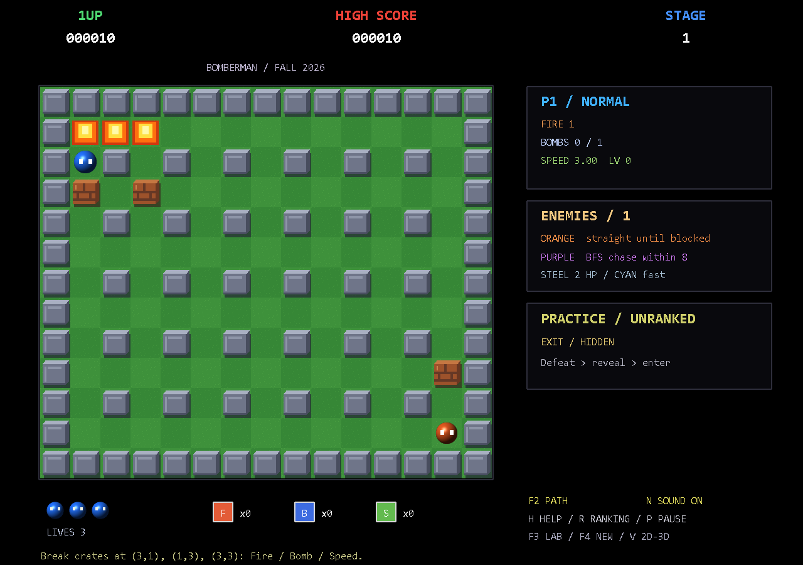

# 17:29 commit 수정 메모

2026-11-22 로컬 검토용 변경 기록. 요청한 커밋 제목은 `17:29 commit`이다. 커밋·푸시는 사용자가 직접 진행한다.

## 변경 사항

- **2인용 삭제**: 게임 코어의 플레이어와 입력을 1명으로 고정하고 2인 시작·두 번째 플레이어 조작·HUD·안내를 제거했다. 홈에서 `2`를 눌러도 시작되지 않는다.
- **방향키 전용 이동**: ↑ ↓ ← →만 사용한다. WASD는 움직이지 않는다. Space 폭탄, Q 종류 변경, E 원격 기폭은 유지한다. 짧게 누르면 한 칸, 유지하면 연속 이동하는 기제는 그대로다.
- **부서진 블록 칸에도 화염**: 일반·원격 폭탄은 해당 칸까지 화염을 만들고 멈춘다. 관통 폭탄은 해당 칸에 화염을 만든 뒤 진행한다. 단단한 벽은 태우지 않는다.
- **새 아이템 보호**: 같은 연쇄폭발의 `waveId`와 아이템의 `protectedWave`를 연결했다. 방금 나온 아이템은 그 연쇄폭발에 사라지지 않고, 화염이 사라진 뒤 획득할 수 있다. 다른 폭발에는 파괴된다. 화염에 가려져 있는 동안 팝업 시간도 멈춘다.
- 원격 `524dacd` (`fire range update`)를 반영해 기본 화력 1에서 Fire 획득마다 +1이 된다. Fire 3개면 화력 4이며, F/B/S 획득 개수 표시도 유지했다. 기존 랭킹 파일 형식은 읽을 수 있고, 새 기록은 1인으로 저장한다.

## 직접 실행·확인

1. 이 저장소 루트의 **`Run Demo.cmd`**를 실행한다. 기본 실행 파일은 **`.\build\BombermanDemo.exe`**이며, 원격 Fire 변경과 로컬 수정이 모두 반영돼 있다.
2. 홈에서 `2`가 반응하지 않는지 확인한 뒤 Space로 시작한다. 준비 화면은 Space/Enter로 넘길 수 있다.
3. 방향키의 짧은 입력·길게 누르기를 확인하고 WASD가 움직이지 않는지 확인한다.
4. F3을 세 번 눌러 Items 장면에 들어간다. →로 (2,1), Space 설치, ←로 (1,1), ↓로 (1,2)에 피한다. (3,1)의 블록이 파괴될 때 해당 칸의 화염을 확인한다.
5. 화염이 사라진 뒤 Fire를 획득하면 화력이 2, F 획득 개수가 1이 되는지 확인한다. Fire를 추가로 획득하면 화력이 3, 4로 계속 증가하는지도 확인한다.

## 코드·검증

- `src/game.hpp`, `src/game.cpp`: 1인 고정, 블록 칸 화염, 폭발별 아이템 보호 및 획득 시점.
- `src/main.cpp`: 방향키 전용 입력, 2인 명령 제거. 개발용 `--capture-ui=flame`으로 블록 파괴 칸의 화염을 고정해 캡처할 수 있다.
- `src/renderer.cpp`, `src/retro.cpp`: 클래식·3D 화면의 메뉴·도움말·HUD 안내 정리.
- `tests/test_game.cpp`: 게임 회귀 73개. T11/15/37/43과 T71~73이 새 화염·아이템 규칙을 확인한다.
- `tests/test_controls.cpp`: 실제 Win32 메시지 경로의 입력·화면 전환 8개. 방향키 4개, WASD/2인 키 무반응, Space·Q·E를 확인한다.
- README의 코드 영역·함수 줄 번호는 `scripts/update_code_map.py`로 다시 생성한다.

## fire range update 통합

원격 `main`의 `524dacd`를 기준 커밋으로 가져왔다. 겹치는 화력·HUD·테스트·설명은 교차 비교해 Fire 획득마다 +1을 반영했고, 로컬의 1인 전용·방향키 전용·블록 칸 화염·새 아이템 보호를 유지했다. 이 로컬 변경은 커밋·푸시하지 않았다.

## main 로컬 경로 정리

실제 수정 소스는 `final_project` 저장소의 `main` 브랜치 `src/`에 있고 Git 추적 대상이다. README와 이 메모도 Git에서 제외되지 않는다. 별도 빌드 폴더를 지정할 필요 없이 루트의 `Run Demo.cmd`로 실행한다. 검증된 실행 파일은 기본 `build/`에 복사했다. 소스와 메모를 로컬 미커밋 상태로 유지한다.
