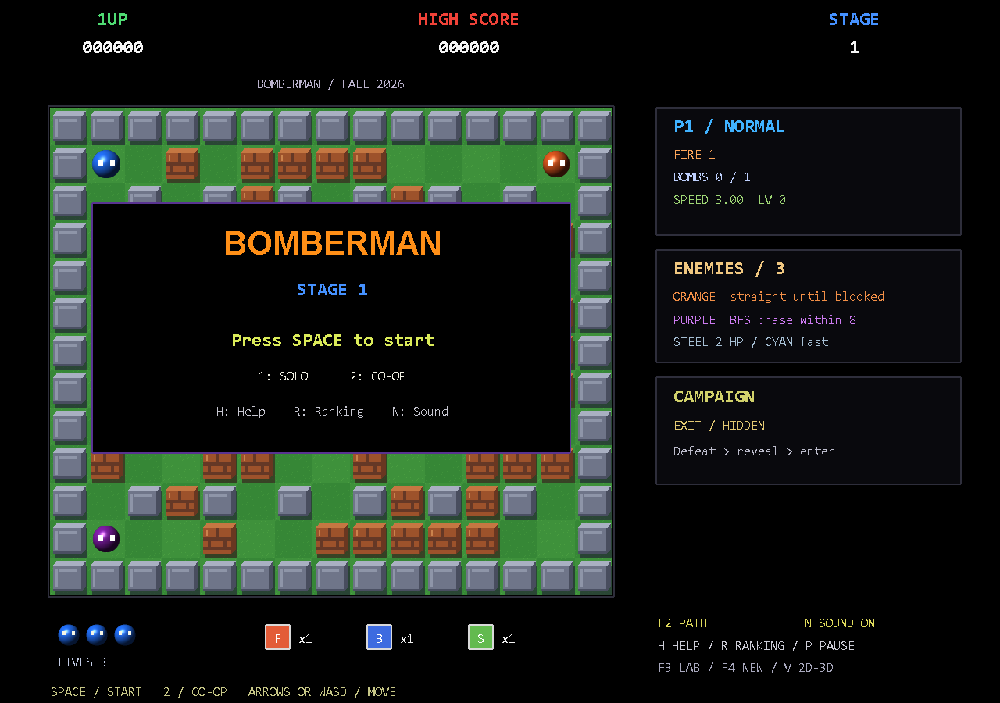
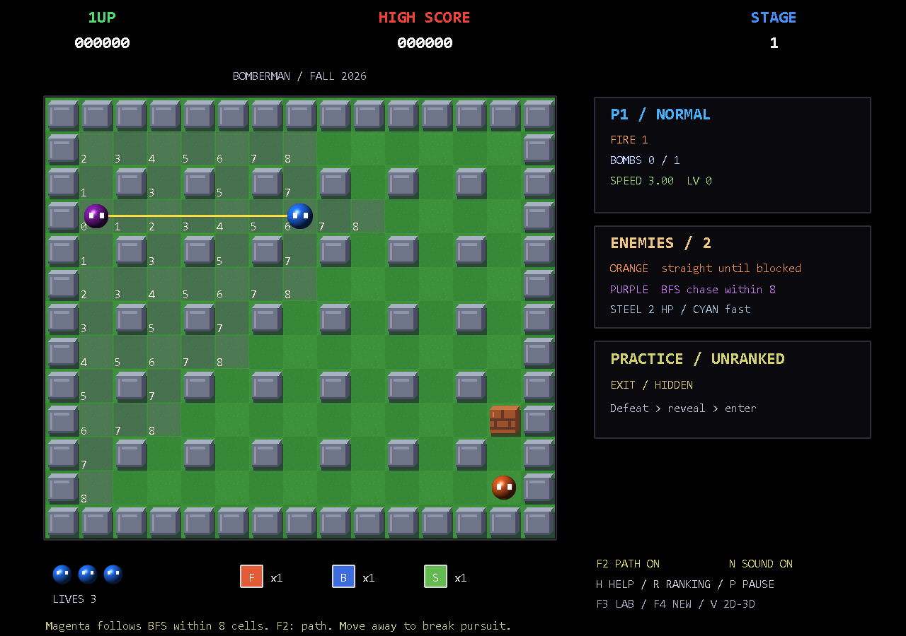

# 1122(4) UI/UX 반영

기준: `final_project_modification/1122(4)/Bomberman.cpp`. SHA256: `82e30667eb816497efdf4f4733a9f3ba5be67bbec8a7cdcb508574bf133a6fb6`.
작업 브랜치: `ui_ux_branch`. 최신 main의 Visual Studio 솔루션과 중복 이동 입력 수정에서 이어서 작업했다. 이후 17:29 수정으로 1인 전용·방향키 전용이 되었다. [최신 변경 메모](CHANGES_1729.md)를 함께 확인한다.

| 요청 | 반영 |
|---|---|
| 1. UI/UX | 초록 체크 바닥, 올라온 블록 면, 방향광·반사광이 있는 파란 플레이어/주황 일반 적/보라 chaser, 1UP/HIGH SCORE/STAGE 헤더, 목숨·F/B/S 획득 개수 배지를 OpenGL 텍스처로 이식. F/B/S는 0부터 시작해 획득 시 증가하며, 추가 기능의 상태는 오른쪽 HUD에 표시 |
| 2. 방향키 | 1인 전용이며 이동은 방향키만 지원. 2인용 시작·조작 경로 제거. Space 시작·재시작, H 도움말, R 랭킹, N 사운드. 기존 F1/Tab/M 별칭 유지 |
| 3. 적 동작 | 일반 적은 막히기 전까지 직진. chaser는 8칸 이내 BFS 경로를 먼저 따라가며 그 밖에서는 일반 이동. 막힌 경우 다른 길이 있으면 즉시 U턴하지 않음. F2는 탐색 영역·거리·최단 경로 표시 |
| 4. 화력·아이템 | 기본 1칸. 벽 아래 Fire가 벽 파괴 시 나타나며 획득할 때마다 화력이 1칸씩 증가. Bomb/Speed 강화도 유지. 노출 직후 팝업 애니메이션 |
| 5. 이동 기제 | 원본 main의 `Game::moveActor`와 `movement.hpp`를 유지. 화면에서도 실수 좌표를 사용하여 칸 단위 순간이동 대신 연속 이동. 두 칸 이동 회귀 테스트 유지 |
| 6. 홈/STAGE | 홈을 타이틀 로고·클래식 미리보기 맵·Space 시작 안내로 재구성. 방향키 이동·폭탄과 도움말·랭킹·사운드 키를 표시. 각 단계 시작 전 STAGE # 준비 화면은 유지 |

## 유지한 기능과 범위

3개 스테이지, 특수 폭탄·적, 3목숨, 연쇄반응, 저장되는 상위 10개 랭킹, 사운드, F3 기능 시연을 유지한다. 모든 화면은 클래식 2D 렌더러를 사용한다. Fire 아이템은 획득할 때마다 화력을 1칸씩 올린다.

참고본의 정수 칸 이동은 가져오지 않았다. 참고본에서 블록 파괴 시 숨은 아이템을 지우는 처리와 피격 시 죽은 적을 되살리는 처리도 기존 main의 검증된 규칙으로 유지했다. 맵 편집기·레코드 파일 위치 변경은 이번에 지정한 6개 항목의 범위에 포함하지 않았다.

## 구조

- `src/retro.cpp`: 원본 GDI 도형의 색상·입체 면과 구체 조명을 64×64 RGBA 텍스처로 생성한다. 외부 이미지 파일은 필요 없다.
- `src/main.cpp`: 홈·STAGE 준비 상태, 참조 키의 별칭, 방향키 전용 1인 입력를 연결한다. 키다운은 기존 공용 함수가 첫 물리 틱에서 한 번만 처리한다.
- `src/game.cpp`: 1인 고정, Fire 누적 강화, 블록 칸 화염·연쇄폭발별 새 아이템 보호, 일반 적·BFS와 팝업 시간을 구현한다. 연속 이동 기제는 유지한다.
- `tests/test_controls.cpp`: 실제 앱 소스를 포함하되 WinMain을 제외하고, 생산 코드의 Win32 메시지 처리 함수를 호출한다. OS에 키를 주입하지 않는다.

## 검증

현재 게임 규칙 85개와 Windows 입력/화면 흐름 18개를 CTest로 검증한다. 기존 2인용 회귀는 1인 전용 검증으로 교체했고, 부서진 칸 화염·아이템 보호·획득 시점·창 크기별 화면 비율 회귀를 추가했다. 화면 검증은 [검증 기록](VALIDATION.md)을 참고한다. Windows 화면 자동화 도구는 시작 오류 1920으로 실행되지 않아 직접 OS 입력 대신 실제 키 메시지 처리 경로 테스트를 사용했다.

개발용 화면 재현은 실행 파일에 `--capture-ui=home`, `arena`, `ready`, `bfs`, `flame`, `stage2`, `help` 중 하나를 전달한다. 네 프레임을 그린 뒤 실행 파일 옆 `capture.bmp`를 저장하고 종료한다. 시뮬레이션은 캡처 동안 정지한다.

